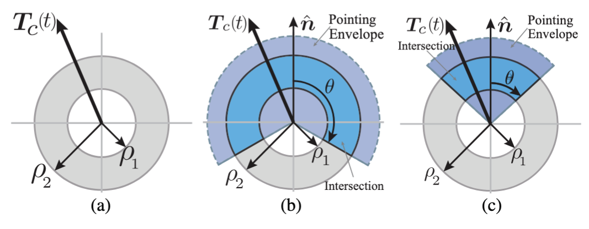
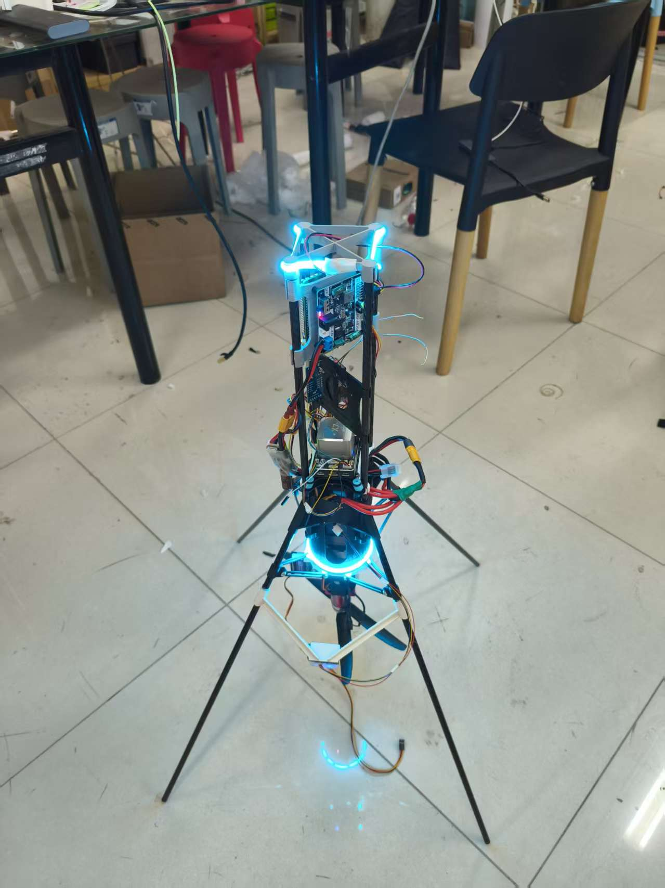
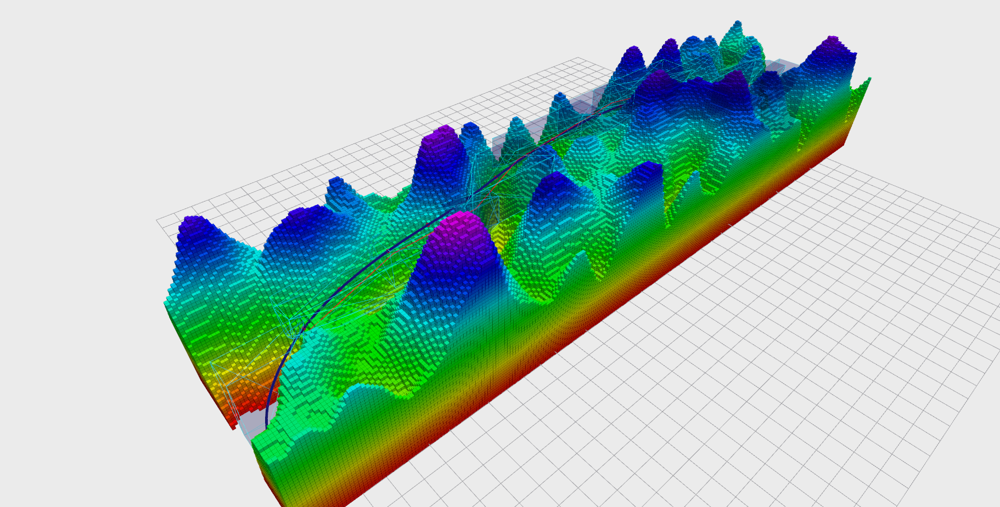

# 项目
目前为止投入精力最大的四个项目是：

### 学习并复刻无损凸优化算法(Lossless Convex)

项目地址为： https://github.com/Lrencheng/LosslessConvex

> 插个图片显得很NB

### 2048强化学习小项目

[点击查看或下载 PDF](./2048人工智能实验报告.pdf)


<iframe
  src="./2048人工智能实验报告.pdf"
  width="100%"
  height="600px"
  style="border: 1px solid #ddd; border-radius: 8px;"
  title="2048人工智能实验报告">
  

    浏览器不支持内嵌 PDF，请
    <a href="./2048人工智能实验报告.pdf" target="_blank" rel="noopener">
      点击打开 PDF
    </a>。
  

</iframe>

项目地址为： https://github.com/Lrencheng/gym-2048

> 这其实是一个课程大作业，我做上头了想要让CNN策略网络自我进化刷分，但是惨遭失败（现在回想起来还是训练方法不对）。

### 推力矢量控制的共轴双桨无人机[大学生创新创业项目]

>该项目非常费钱！！！

### 面向火星探测器的安全可跟踪轨迹快速规划[仍在开发]

这真的是我目前做过~~最有成就感的项目了~~最可以讲故事的项目。

> 其实是经典 A+B 式创新

# 研究兴趣

我的研究兴趣包含硬件与算法。

## 硬件
1. 新形无人机结构。本科期间曾经亲手设计共轴双桨推力矢量无人机，搞坏了2个高精度舵机痛失300大洋。

2. 飞行操作机器人。研究生有机会我很想搞一下带夹爪或者机械臂的无人机，我总是觉得现在的无人机说破天了就是个大号飞行相机，得带执行器才能操作真实世界。还有一个原因是带执行器的无人机也许可以使用强化学习算法实现敏捷控制与精准抓取，如果我能做出飞行夹爪无人机 + sonic级别强化学习模型我都不敢想我会觉得自己有多屌。

## 算法
1. 轨迹优化。我本科一致致力于开发火星探测器的轨迹优化算法，这项工作是非常traditional的数学方法，但是这个工作激动人心的地方在于，我没有按照航空航天一脉相承的凸优化算法继续做，而是吸纳了无人机轨迹优化领域的先进算法实现了还不错的效果。

2. 强化学习。在机器人控制器领域：RL以其强大的泛化和实时性能横扫了机器人界，毫无疑问地击败了MPC。但是在无人机领域，控制器仍然被传统的串级PID和MPC算法占据，这很大程度上是因为我们如果只是控制四旋翼的话上面的算法以及够用了，但是如果有操作执行器呢？我们要笨拙的将系统进行粗暴的解耦吗，如果只是做“飞到A点保持不动，夹取一瓶可乐，再飞到B点”这样的pipeline的话，我都不敢想这背后的编程量有多大。我会说，ok我们来做无人机界的sonic吧，我们先设计一个标准的具身无人机，然后设计一个通用RL控制器，在仿真中赋予这个RL控制器敏捷飞行和精准操作的能力，或者说得更激进一点：消灭飞控。

3. 端到端飞行。什么才是最振奋人心的工作，那必然是端到端飞行。我们知道这一定可以实现因为鸟类就是这样。

